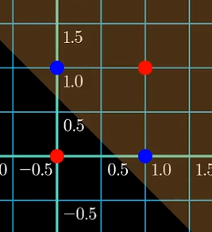
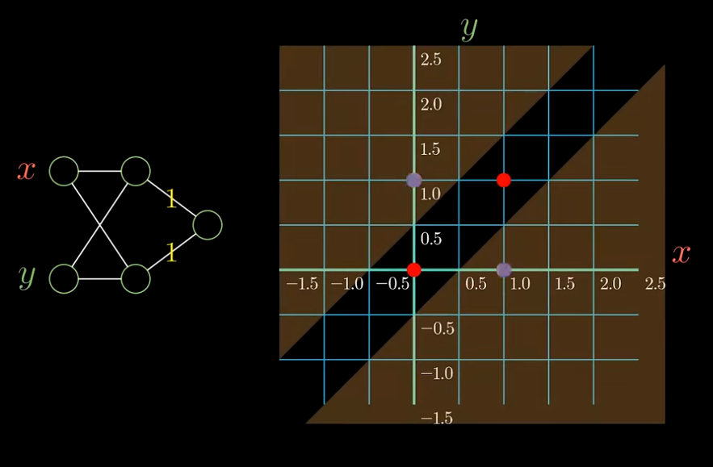
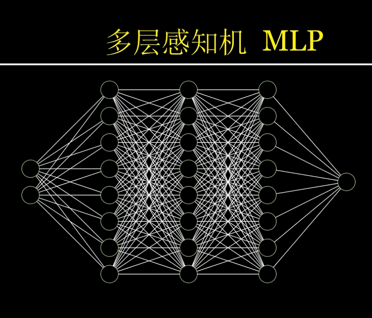
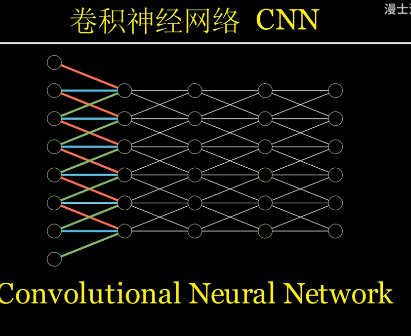
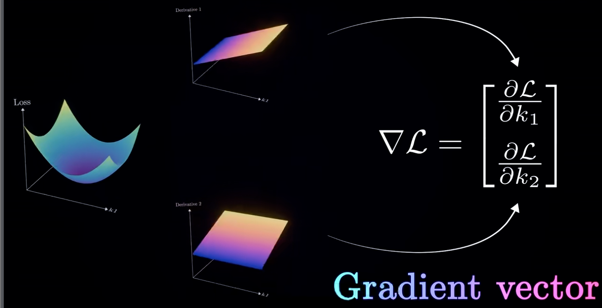
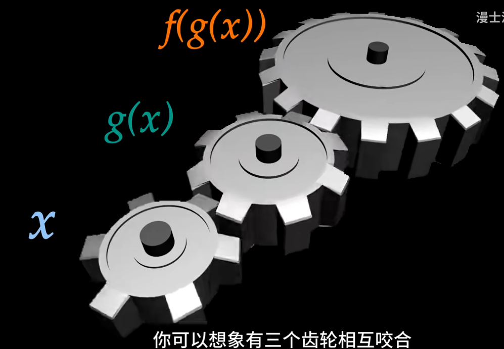
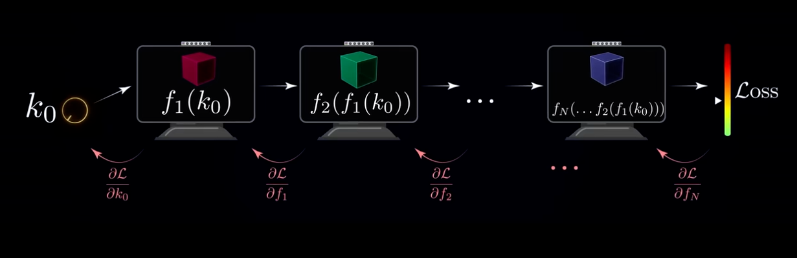
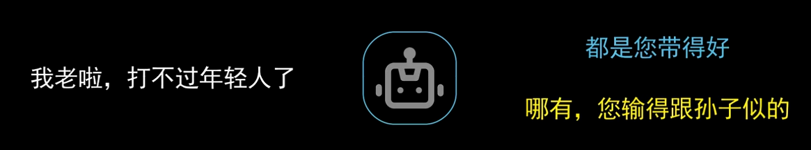
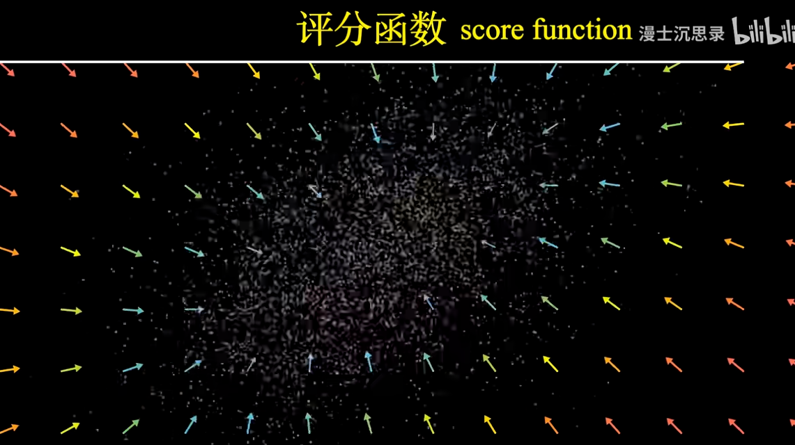

# 一口气搞懂人工智能和神经网络

[90分钟！清华博士带你一口气搞懂人工智能和神经网络](https://www.bilibili.com/video/BV1atCRYsE7x/?share_source=copy_web&vd_source=cb9a80fa16ae7c0ba4ec951d606d4b42)

<iframe src="//player.bilibili.com/player.html?isOutside=true&aid=113332711333508&bvid=BV1atCRYsE7x&cid=26360022345&p=1" scrolling="no" border="0" frameborder="no" framespacing="0" allowfullscreen="true"></iframe>

---
# 深度学习
**智能**，本质上就是针对不同情景给出针对性的输出反应(趋利避害)

**人工智能：** 搭建起一个针对不同的环境信息, 给出针对性的输出和回应的系统

- 输出可以是动作、语言、判断和预测(GPT根据上文不同的问题和任务的要求针对性的说活并解决问题).

**智能：** 找到情景信息的输入与我们想要的输出之间的函数对应关系

> Functions Describe the World!
>
> Sound, light, matrices and Mathematics!

**AI函数：** 定义的输入和输出的黑箱函数和人没有任何区别

## 智能
1. 符号主义
   **从符号和规则计算出推理和思考**
   - 典例：专家系统
   - 致命缺陷：
     - 现实世界没有清晰直接的规则
     - 完全复制人类经验，无法提升自身水平
2. 机器学习
   **通过引导和学习，让其在某任务上表现的越来越好**
   - `奖励` 与 `惩罚` 机制(反射)
   - 自我调整

- **模型结构：** 哪来这种神奇黑箱？
- **损失函数：** 怎么奖励一个机器？
- **训练过程：** 机器怎么建立条件反射？
***
### 1. 怎么搭建有学习能力的黑箱？

> 联结主义(Connectionism)：通过仿生的方式, 模拟单个神经元的复杂功能以及神经元之间的复杂连接

*与符号主义同源*

**搭建黑箱：** 使用一系列的属性(所有特征)描述事物, 用1表示符合, 0表示不符合

符合特征乘正系数, 不符合乘负系数, 求和获得评分, **设置得分阈值，高于阈值时激活感知机**

- **感知机：** $\sum_{i = 1}^nw_ix_i - b$
- 最早期借鉴脱胎于符号主义
- 与神经科学不谋而合
  - 通过电信号传递信息, 树突接受, 轴突传递
  - 可能通过输入抑制或激活神经元活动, 神经元直接叠加所有刺激的影响

**模式识别：** 从输入数据中识别不同特征的模式，理解概念的过程

- 计算机视觉: 通过对数字组成的矩阵纯粹的计算, 得出答案(照片里的是男人?是女人?)

>人类对于自己不了解的东西很容易浪漫, 也很容易对未来过分乐观！

#### 怎么搭建黑箱(例如感知机等模型)?

**联结主义的信念：**

通过设计某套参数, 使模型设计足够强大，**任何想要实现的功能本质上都可以通过设定某套参数实现**

- 反对: “机械模拟”, “结构太简单”
- 致命弱点: 感知机无法完成 XOR!

| x | y | x XOR y |
|---|---|---------|
| 0 | 0 | 0 |
| 0 | 1 | 1 |
| 1 | 0 | 1 |
| 1 | 1 | 0 |

- 将所有 $x, y$ 输入画在二维平面上，感知机能做到的仅仅是**线性规划问题**，满足激活和不激活的分界线永远是一条直线
- 
- 如图所示，**不可能存在一条直线让这样的激活成立**

> 人类又是这么悲观, 一个小小的反例就自暴自弃, 放弃了充满潜力的研究方向！

最后坚持下来的那批人, 终于守得云开见月明, 成为了我们如今深度学习的奠基人

**多层感知机** $\mathrm{MLP}$

对于 XOR，我们考虑**多层嵌套感知机**，前一层的感知机输出作为下一层感知机的输入

- 
- x 只在 (1, 0) 激活 ($1x + (-1)y > 0.5$)
- y 只在 (0, 1) 激活 ($(-1)x + 1y > 0.5$)
- 分别关注我们想激活的位置, 将神经元的输出相加

*大名鼎鼎的神经网络中最经典、最基础的一种*

#### 深度学习的重要课题：如何设计更好更强大的模型结构？

视觉系统中，神经系统的神经元不需要和前一层的所有神经元全部稠密连接，只需要和**局部神经元连接**即可，并且每层神经元连接的结构是类似的

借鉴这一点而**减少计算量、提高性能**，设计出了 **CNN (卷积神经网络)**

**残差网络(ResNet)：** 卷积层堆多训练有困难，增加了一种跳跃式的连接(跳过中间某些层直接连接)

**DenseNet：** 将任意两层都跳跃连接起来

**Transformer(Attention)：** 本质上也是某种网络的基本结构

深度学习非常重要的领域：**神经网络结构设计**

通过**数据训练**发现蕴藏的结构，理解概念
***
### 2. 究竟如何奖励和惩罚一个神经网络?

各种人工智能无一例外都在使用**梯度下降**算法训练网络，来找到最好的参数

#### 梯度下降

回顾 智能的本质就是从一堆点中找到一个拟合他们的关系的函数

线性组合一个 $(C, x, x^2, x^3, ...)$, 用多项式函数拟合
此时有 $y(x) = k_0 + k_1x + k_2x^2 + k_3x^3 + k_4x^4 + k_5x^5$

**损失函数：** 用一种定量的方式度量一组系数所对应的多项式到底拟合得好不好

衡量一个模型的预测和真实结果之间的**偏差程度**

这里有两种函数:

1. **拟合函数**
2. **损失函数**(计算真实结果与拟合函数的预计值之间的残差平方和)

**目的：** 找到最出色的 parameters：$\{k_0, k_1, k_2, k_3, k_4, k_5\}$

> 中学: 最小二乘法

这样，训练神经网络就成为了一个**通过调节参数旋钮来降低损失函数的游戏**

数学上处理这个问题叫做**非凸优化**，求解它的难度是臭名昭著的大

**梯度下降 + 反向传播**

我们首先只考虑其中一个参数k, 假设其他参数已经调节到最优
我们能得到的信息只有函数上离散的点
但是我们还可以知道这些离散的点的导数

**梯度下降的精神：**

- **每次减小一点点：** 每次减小损失函数，我们现在的位置应该往哪边走，然后往这个方向走一个很小的距离，这样我们就可以不断缩小损失函数，直到停在底部，参数基本不再变化
- 同时调节两个参数$k_1$, $k_2$时, 损失函数变成输入是两个实数, 输出是一个实数的二元函数, 可以表示成一个二维曲面
- **偏导数：** 固定其一只调节另一个
- **梯度**(本质上是一个 n 维向量)：把两个偏导拼成的列向量(二维版本的求导)，在某个给定位置函数值变化最快的方向(曲面在局部最陡峭的方向)
- 梯度给出了二维曲面上每个点**上升最快的方向**，梯度下降法就是反其道而行之

- 类似的，我们沿着梯度下降的方向每次调整一点点就可以减小损失函数
- 这启发我们任意个参数都可以这样做
- 对于我们的5个参数的函数，损失函数是一个六维曲面

因此，我们需要分别对每个参数求偏导，**组合成一个梯度，找到梯度下降的方向**。

$\nabla$算子介绍

>$\nabla$ 叫 **nabla 算子**，也叫**向量微分算子**
即 $∇ = (\frac{\partial}{\partial x_1},\frac{\partial}{\partial x_2},\frac{\partial}{\partial x_3},...)^T$
> - 作用于标量函数(标量场$f:\mathbb R^n\to \mathbb R$)可得 **梯度(gradient)**
> \[\nabla f = \left(\frac{\partial f}{\partial x_1},\frac{\partial f}{\partial x_2},\frac{\partial f}{\partial x_3},...\right)\]
> - 与向量场($\mathbf F:\mathbb R^n\to \mathbb R^n$)点乘可得 **散度(divergence)**
>\[\mathbf F = (F_1, F_2, F_3, ...)\]
其中每个$F_i$是$x_1, ..., x_n$的函数
\[\nabla\cdot\mathbf{F} = \frac{\partial F_1}{\partial x_1} + \frac{\partial F_2}{\partial x_2} + \cdots + \frac{\partial F_n}{\partial x_n}\]
> - 与向量场叉乘可得 **旋度(curl)**
> \(\nabla\times\mathbf F\)

---

> [!TIP]
> **梯度下降法可以优化网络，找到损失函数比较低的参数**

对于一个非常复杂的网络，我们如何计算这个梯度？

<b>反向传播(back propagation)</b>

**反向传播：** 专门用于计算复杂神经网络梯度的算法，是**很多人学习深度学习被劝退的第一步**

**最精髓的思想：** 神经网络本质上是用最基础的运算组合、复合、迭代而形成超级复杂的函数(由基础的积木拼接成的庞大机器)，我们只关心每个调节参数的旋钮的梯度(动一点点，损失函数随之变化的关系)，而这个信息是可以**由后向前层层传递**的

**导数的链式法则：**

$\dfrac{\partial f(g(x))}{\partial x} = f'(g(x))g'(x)$

> [!NOTE]
>三个齿轮转过的角度分别代表x, g(x), f(g(x))
g'(x)表示第二个齿轮g(x)相较于第一个齿轮x传动的速度之比
f'(g(x))表示第三个齿轮相较于第二个齿轮g(x)传动的速度之比
如果想直到变动一点点第一个齿轮, 第三个齿轮变化的速度会有多快, 我们就只需要把这两个齿轮的传动比相乘

有了链式法则，我们就可以**从后往前一步步拆解，得到每个参数的导数**。

(这里每层的偏导标注有误，应该是**后一层对前一层的偏导**)
从图片考虑, 损失函数就是参数经过多层函数复合后得到的输出

要求最初始的导数，我们就可以一层一层将每层之间的偏导从后往前相乘
这个算法就叫做**反向传播算法**

### 泛化(Generalization)

**推广、举一反三、活学活用**

最简单的泛化：将关联的趋势理解并且推广到**我们没有见过的一些输入数值**，通过理解底层规律，在未知的情景下给出合理的预测和输出
零散的数据点勾勒出了一种趋势，当我们用一个**连续平滑的函数**准确刻画出这种趋势之后, 就可以利用这个函数, 推测出数据中我们**没有见过的某一个输入下**, 对应合理的输出大概是多少

现实中的泛化往往非常抽象，不如曲线拟合这么直观
这正是神经网络强大的地方：**你只需要提供数据，底层抽象的趋势和规律交给神经网络自己学习**

不同情境中类似的有一种感觉和规律，难以用简单清晰的数学来计算和描述

**例：**

- 围棋？味道不好。
- 说话？一句话前面的语境下，后面应该接上一个什么样的话
- 
- 从氨基酸序列里分析出整个蛋白质的结构？(诺奖)

### 为什么深度学习强？

你只需要找一个**架构合适的神经网络**，收集数据，训练拟合，然后这个神经网络就会领会数据当中你所描述的输入和输出间微妙的联系，并举一反三，运用到它没有见过的情景输入中。

### 神经网络、深度学习是万能的吗？

尽管深度学习模仿了人类大脑的结构，但是它和真正的人类智能还有很大的区别。
因为神经网络对概念的**相关性和因果性没有把握**：这是收集数据、训练模型的这一套方法论中永远无法避免的。

**对抗样本：** 在人眼中看起来是杂乱无章的噪声，但是会导致神经网络将其看成与某些其他特定事物相同的样本
***
***
# 语言模型
### 生成式语言大模型：预测下一个语素 **<mark>next-token-prediction</mark>**

大模型本质上只是在做**接话和完形填空**，和人类的语言有非常明显的不同

### 生成式语言大模型是如何洞悉语言的规律？

**语言的本质：如何传递信息和意义**

语言的规律：理解每一个 token 在现实世界中对应的含义，以及它们以什么样的内在规律一个接一个地出现，这种出现的序列整体传递了一个什么意思

**计算语言学的核心问题**

语言模型：计算语言学
语法本质上就是一个描述词性和搭配要求的简单语言模型。

**但是满足语法的句子不一定有特定的含义。**
> <u>Colorless green ideas sleep furiously.</u>
因此，**语法不能用来描述语言的本质**

**输入法：** 最简单的语言模型，即 **n-Gram Model**

**统计语言模型(Statistical Language Model)：** 基于某一个长度的上文，使用一种统计的方法来预测下一个词的模式

#### **GPT：Generative Pre-trained <mark>Transformer</mark>**
**Transformer：** 作为深度学习中最强的模型之一，它可以举一反三地从训练数据中，学习输入到输出的规律
延申

- 怎么把一个词汇转换成一个向量

**next-token-prediction：** 蕴含着对于这个词语的含义、整个句子的语法，以及它在文化以及现实世界的含义里是否合理的深刻理解

把前面自己生成的输出当作新的输入条件的方式叫做**自回归生成**
从一个问题开始自回归生成，就可以解决这个问题(类似AC自动机?)

**幻觉(Hallucination)**

> 没有在真实的环境中生活，难以检验一个信息的真假

*大模型通过物体在光中留下的阴影理解这个世界*

### 大模型如何有用地**接话**？

两个训练过程:

1. **监督训练微调(Supervised Fine-tuning)**
   在某些特定领域中完成训练，熟悉该领域的知识
2. **人类反馈提升 RLHF(Reinforcement Learning with Human Feedback)**

---
***
# 图片生成
### 扩散模型 Diffusion

墨水散开: 

- 数学：维纳过程 Wiener Process
- 物理：布朗运动 

**高斯分布：** 通过足够长时间的扩散，最终变成看似杂乱无章的一团的分布
>[!TIP]
>其实，这就是概率论中的一个经典结论**中心极限定理 CLT**

物理中研究扩散过程的物理学叫做**朗之万动力学(Langevin Dynamics)**

中心点扩散：对于一个小区域，倒退一段时间，这个区域的粒子会更接近中心点

**正向的扩散：** 机械无脑的热力学过程，无论是什么时候，它下一个时刻的去向都杂乱无章，均匀地向周围渐渐摊开
**反向的扩散：** 从一团混乱的高斯分布中重建出原有的结构(熵减：从混乱变得有秩序，是一个有信息、有方向的过程)

于是，在任何一个时刻t，我们都可以给空间上的每一个位置画出一个向量箭头，表示这个时刻的粒子在$\delta t$时间之前，平均应该在哪
而这样的向量场有一个名字，就叫做**评分函数 score function**

**评分函数(score function)：** 越来越接近粒子最初始位置的导航

**数学上一张图片看起来不是乱来的意味着什么？**

把图片像素每个RGB写下来组成一长串数字的列表，相邻的数字表示图片上相邻的像素
我们可以把每个数字当成一个坐标，于是一张图片就变成了一个向量，这些向量所在的空间叫做**像素空间**

任取像素空间的一个向量，把它的坐标一一转化成颜色，把它翻译成一张照片
这个空间极大部分向量组成的图像都是无意义的，只有极少部分看起来有意义

自然的一张图片通常是由色块组成
**色块**指的是大部分情况下，一个像素相邻区域的像素颜色类似(对像素的数值构建了约束)

除此之外，一张图片要像真的还要有**结构、透视、色彩、光影**等要素

在 AI 的视角下，这些有意义的图片就像在高维空间中一条**金色的矿脉**。

真正重要的是**这条矿脉在高维空间的结构**是什么样的。
这在计算机科学里是一个非常重要的观点，被称为**流形假设(Manifold hypothesis)**

真实图片的生成过程：从这个空间的任何一个位置走到这个流形上的一个点

怎样知道这个评分函数？

- 把输入定义成某个时刻粒子的位置，把输出规定为上一个时刻它的位置
这样**训练神经网络**，本质上就是学习这个**评分函数**

**去噪模型(Denoising Model)：** U-Net 沿着评分函数在空间中一点点移动，在像素空间中会越来越接近真实图片流形的那条矿脉
